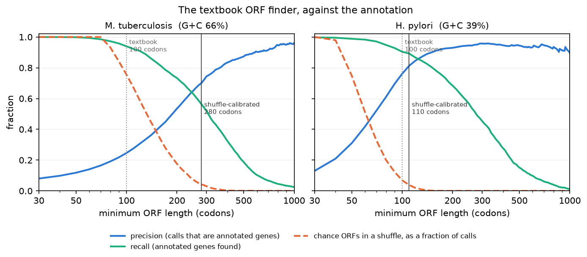
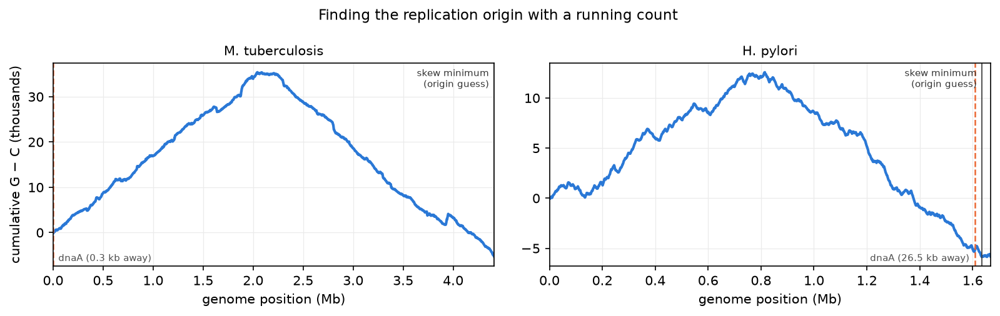

# Old-School Biology Tools

*Part 12 of a series on teaching an AI to read DNA. Last post, a one-line "is this letter G or C?" loop tied my trained neural network at its best trick. So this time the neural network sits out. I built the tools biologists were using decades before anyone trained a language model on DNA, put them behind the same tool schema, and measured them the same way I've been measuring the model. The dumb tools turned out to need the same honesty checks as the smart one.*

---

For eleven posts the question has been "what has the model learned?" That question has a blind spot: learned *compared to what*? I've always compared against the k-gram counter, which is a fair baseline for predicting the next letter. But nobody finds genes by predicting the next letter. Biologists use tools that are simple, deterministic, and fast:

- An **ORF finder**. An open reading frame is a start codon (usually ATG) followed by codons until the first stop codon (TAA, TAG or TGA). Genes are ORFs, so finding long ORFs is the oldest gene-finding trick there is.
- A **GC scan**. G+C content in sliding windows, plus the **GC skew**, (G−C)/(G+C), which turns out to locate where a bacterium starts copying its chromosome.
- A **restriction map**. Restriction enzymes cut DNA at specific short sequences (EcoRI cuts at GAATTC). Knowing where they cut is everyday lab work.

None of these need a neural network, a GPU, or a checkpoint. In the bridge they don't even load the model: the dispatcher answers them before the model is touched, and a test makes sure it stays that way. The frontier model can now call `dna_find_orfs`, `dna_gc_scan` and `dna_restriction_sites` right next to `dna_score_report` and `dna_variant_report`.

Building them took an afternoon. Measuring them is where it got interesting.

## The ORF finder, against the annotation

The textbook rule is: **an ORF of at least 100 codons is probably a gene.** Short ORFs show up by chance all the time, long ones rarely do, and 100 codons is the usual cutoff.

I ran the ORF finder over the two genomes the model has never seen, *M. tuberculosis* and *H. pylori*, and checked every ORF against the genome's annotation. An ORF counts as a real gene if its stop codon matches an annotated gene's stop codon on the same strand. (Matching on the stop is the standard convention. Start codons are ambiguous, and stop codons aren't.)

| ≥100 codons | *H. pylori* (39% G+C) | *M. tuberculosis* (66% G+C) |
|---|---|---|
| ORFs called | 1,722 | 14,883 |
| that are annotated genes (precision) | **76%** | **25%** |
| annotated genes found (recall) | 90% | 94% |

The same rule, the same code, gives two very different answers. In *H. pylori* the 100-codon rule does its job. In *M. tuberculosis* three out of four "genes" it finds aren't genes.

## Why: stop codons are written in A and T

Look at the stop codons again: TAA, TAG, TGA. Every one of them is mostly A and T. In a genome that's two-thirds G and C, A and T are rare, so stop codons are rare too, and an ORF can run on for a long time before it happens to hit one. Long ORFs stop being evidence of anything.

That's a claim I can test, with the move this series keeps coming back to: **shuffle the genome**. Same letters in the same proportions, order destroyed, so there are no genes left. Then run the same ORF finder over the shuffle. Every ORF it finds is there by chance.

The dashed orange line is the number of chance ORFs in the shuffle, as a fraction of the ORFs called in the real genome. At 100 codons:

- *H. pylori*: the shuffle holds **118** ORFs that long, 7% of the real calls.
- *M. tuberculosis*: the shuffle holds **11,239** ORFs that long, 76% of the real calls.

The longest ORF in a shuffled *H. pylori* is 182 codons. The longest in a shuffled *M. tuberculosis* is **562 codons**, with no gene in sight.

So the cutoff shouldn't be a constant. It should come from the shuffle: the shortest length where chance ORFs make up at most 5% of the calls. That gives **110 codons** for *H. pylori*, close to the textbook number, and **280 codons** for *M. tuberculosis*, nearly three times longer. At 280 codons, precision in *M. tuberculosis* goes from 25% to 70%. The price is recall: it now finds only 56% of the annotated genes, because plenty of real genes are shorter than 280 codons. There's no free lunch, only an honest tradeoff, and now you can see where you're standing on it.

Each ORF that `dna_find_orfs` returns now carries a `shuffle_p`: how often a composition-matched shuffle of the same sequence contains an ORF at least that long. A 300-codon ORF with a high `shuffle_p` means "this sequence is GC-rich," not "this is a gene."

## What the shuffle can't catch

After calibration, *M. tuberculosis* still has 938 false ORFs. I sorted them by where they sit:

| false ORFs ≥280 codons, *M. tuberculosis* | count |
|---|---|
| on the **opposite strand** of a real gene | 726 |
| inside a real gene, same strand, different frame | 156 |
| outside any gene | 56 |

Three-quarters of them are **shadows**: long ORFs running backwards through a real gene on the other strand. They're a known nuisance in GC-rich genomes. Read backwards on the opposite strand, a stop codon would need A's and T's to land on the gene's most GC-rich codon positions (about 80% G+C at position 3), and they almost never do. So every real gene casts a long ORF on its other side.

The shuffle can't model this, because shadows don't come from base composition. They come from the gene itself. The composition null cleaned out chance; it can't clean out structure that's real, just on the wrong strand.

That's the most interesting thing this post found, and it sets up the next one. Part 11 showed the neural model knows which codon position it's at from the left context alone, with the right G+C at each position. A shadow ORF read in its own direction has the wrong rhythm. **Can the model tell a gene from its own shadow, when the ORF finder can't?**

## One more thing the ORF finder gets wrong

When it does find a real gene, the ORF finder reports the longest version, from the earliest start codon. The annotated start matches only **53%** of the time in *M. tuberculosis* and **75%** in *H. pylori*. Real genes often start at a later start codon, and nothing in "ATG…stop" can tell you which. Starts are a job for later posts on promoters and ribosome binding sites.

## Finding where the chromosome starts copying, with a running count

This is my favourite old-school trick, and it needs no model at all.

A bacterial chromosome is a circle, and it's copied from one point, the **origin**, in both directions at once, until the two copies meet on the far side at the **terminus**. The two DNA strands get copied in different ways, and over millions of years that leaves a faint bias: one half of the circle has slightly more G than C on a given strand, and the other half has slightly more C than G.

Walk along the genome keeping a running total of G minus C. It climbs on one half and falls on the other, so its **minimum marks the origin** and its maximum marks the terminus.

The best-known landmark next to a bacterial origin is the gene *dnaA*, whose protein starts replication. Here is how close the running count lands:

- *M. tuberculosis*: the skew minimum is **0.3 kb** from *dnaA*, on a 4.4-million-letter genome.
- *H. pylori*: **26.5 kb** away, about 1.6% of the genome. That's close, but not exact. *H. pylori*'s curve is noisier, and I'm reporting the miss rather than picking a definition that hides it.

The maximum sits about half a genome away from the minimum in both (0.46 and 0.49 of the circle), as the origin–terminus picture says it should.

My model can't do this, and that isn't a dig at it. It reads 256 letters at a time, and this signal only exists across millions of them. Some questions belong to the tool that can see the whole genome at once.

## The enzymes a genome avoids

Last, the restriction map. Counting sites is easy. The interesting question is whether a genome has *fewer* sites than it should. Bacteria use restriction enzymes to chop up invading viral DNA, and a genome full of its own enzymes' target sites would be a liability.

So I compared each site's count with the average count in shuffled versions of the genome. *H. pylori*, which is known for carrying an unusually large number of restriction-modification systems, avoids some sites almost completely:

| *H. pylori* | site | observed | expected from shuffle |
|---|---|---|---|
| SalI | GTCGAC | **0** | 219 |
| XhoI | CTCGAG | 6 | 212 |
| KpnI | GGTACC | 11 | 222 |
| TaqI | TCGA | 304 | 5,789 |

Zero SalI sites in 1.7 million letters, where shuffled DNA has over two hundred.

I'd be careful reading this table too far. My shuffle only keeps single-letter composition, not the codon structure or the frequency of letter pairs, and those shift site counts on their own. *M. tuberculosis* has nearly three times as many SalI sites as its shuffle predicts, which I'd bet is codon structure rather than anything about enzymes. A "zero versus 219" gap survives that caveat. A 0.7 versus 1.0 ratio doesn't.

## What I built

- **`classic.py`**: the three tools as plain numpy. The ORF finder handles all six reading frames at once instead of looping letter by letter, so a whole 4.4-million-letter genome takes about half a second. It's checked against a brute-force ORF finder on random DNA, and every restriction-site and digest answer is pinned by hand in the tests. Because these tools are deterministic, they can be tested exactly, which the neural tools never can.
- **Three new bridge tools**: `dna_find_orfs`, `dna_gc_scan`, `dna_restriction_sites`, bringing the total to 11. Like the others, they return bounded summaries (counts, coordinates, the top few hits) and never the sequence itself. They never load the neural model.
- **`oldschool.py`**: runs every classic tool on one sequence, or the full annotation test above on a held-out genome.

## Where this goes next

The scoreboard so far: the classic tools find long ORFs, locate the replication origin, and spot avoided enzyme sites, and the neural model can't do the last two at all. The model's one real edge, from Part 11, is reading the codon rhythm from context.

The shadow ORFs are exactly where that edge should matter. They're long, they're GC-rich, they pass the shuffle test, and the ORF finder is helpless against them. Post 13, **Neural + Classical, Together**, puts both tools on the same problem: the ORF finder proposes, the model judges, and I find out which one is right when they disagree.
