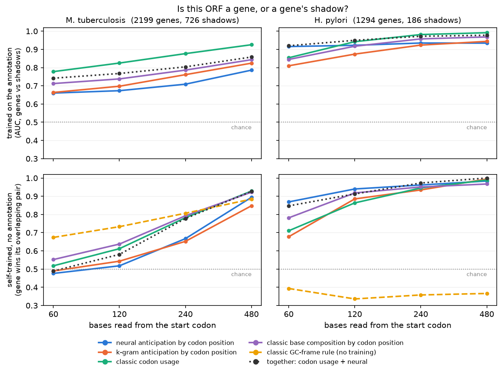

# Neural + Classical, Together

*Part 13 of a series on teaching an AI to read DNA. Last post, the old-school ORF finder left behind hundreds of fake genes that no statistical trick could remove: "shadows" of real genes, running backwards on the opposite strand. I ended with a bet that my neural model, which reads the codon rhythm from context, could tell a gene from its shadow. This post puts the model and the classic tools on that one problem, side by side. The model loses on its home turf, wins somewhere I didn't expect, and the most useful thing turns out to be what happens when the two agree.*

---

## The problem, in one picture

A gene is read in one direction, three letters at a time, on one strand of the DNA. The other strand runs the opposite way. Read it backwards through the same stretch, and in GC-rich genomes you'll often find another long open reading frame: no stop codons for hundreds of letters, exactly like a real gene. That's a **shadow**.

Part 12 found 726 of them in *M. tuberculosis* that survive every filter: they're long, they beat the shuffle test, and to an ORF finder they are indistinguishable from genes. That's not a bug in the ORF finder. Both a gene and its shadow are, by definition, stretches with no stop codons. The finder only looks at stops, so it can't separate them.

What *does* differ is how each one is written. A real gene has a distinctive style at each of the three codon positions (Part 10's "handwriting"). A shadow is that same text read backwards on the other strand, so its style is scrambled. Any judge that can read the style should be able to tell them apart.

## The judges

Every long ORF in the two held-out genomes gets read from its start codon, for the first 60, 120, 240, or 480 letters. Each judge boils that window down to a profile in the ORF's own reading frame:

- **Codon usage** (classic): how often each of the 64 codons appears. This is the core of the gene finders biologists have used since the 1990s.
- **Base composition by codon position** (classic): how often A, C, G, and T show up at codon positions 1, 2, and 3. That's 12 numbers.
- **The GC-frame rule** (classic, no training at all): "in a real gene, the third codon position is the most GC-rich." It's a one-line rule from the GC-frame plots of the 1980s.
- **Neural anticipation**: the same 12 numbers, but from what my model *predicted* at each position before seeing the letter. That's Part 11's signal, now with all four bases instead of just G+C.
- **k-gram anticipation**: the same thing from the order-5 letter counter, the control the neural model has had to beat since Part 2.

And I tested them in two settings:

1. **Trained**: each judge learns what genes and shadows look like from the genome's annotation (on half the ORFs) and is tested on the other half. This is the best case, and it's unrealistic, because a new genome comes with no annotation.
2. **Self-trained**: no annotation at all. Each judge compares every ORF to the average of all the genome's long ORFs. Most long ORFs are genes, so the average looks like a gene. Then the judge refines that: for every pair of ORFs that overlap on opposite strands, it drops whichever one looks less gene-like and recomputes the average. This is a miniature version of how real gene finders bootstrap themselves on a new genome.

The headline number in the self-trained setting is **pair accuracy**: for each overlapping gene-and-shadow pair, does the judge pick the gene? Coin-flipping gets 50%.

## The result

### In *M. tuberculosis*, the old tools win everywhere

| *M. tuberculosis* (66% G+C) | 60 bp | 480 bp |
|---|---|---|
| **trained** (AUC, genes vs shadows) | | |
| classic codon usage | **0.78** | **0.93** |
| neural anticipation | 0.66 | 0.79 |
| k-gram anticipation | 0.66 | 0.82 |
| **self-trained** (pair accuracy) | | |
| classic GC-frame rule | **0.67** | 0.88 |
| classic codon usage | 0.52 | **0.93** |
| neural anticipation | 0.48 | 0.89 |

This is the genome where Part 11 found the model reads the reading frame almost perfectly (99% from 480 bp). It's where I'd have bet the model would shine. Instead, the codon-usage table beats it at every window length, and **the neural model doesn't even beat the letter counter** when trained. Without labels, on short windows, nothing learned is better than a coin flip. The only judge above chance at 60 letters is the one-line GC rule, written decades before deep learning.

I don't know for sure why the model does so badly here. My best guess goes back to Part 11's warning: the model *expects* codons everywhere in GC-rich DNA, even in shuffled sequence. A shadow is GC-rich DNA with a real gene hiding in it backwards, so the model's predictions there still look codon-like, just in a rhythm borrowed from the real gene on the other strand. If that's right, the model's strength (it finds a frame in anything) is exactly what blinds it here. But that's a hypothesis I haven't tested, not a finding.

### In *H. pylori*, the model wins where it counts

| *H. pylori* (39% G+C) | 60 bp | 480 bp |
|---|---|---|
| **trained** (AUC) | | |
| neural anticipation | **0.92** | 0.93 |
| classic codon usage | 0.85 | **0.99** |
| **self-trained** (pair accuracy) | | |
| neural anticipation | **0.87** | 0.98 |
| classic codon usage | 0.71 | **0.99** |
| classic GC-frame rule | 0.39 | 0.37 |

Here the picture flips on short windows. From just 60 letters (20 codons), the model picks the gene 87% of the time with no annotation, against 71% for codon usage. Twenty codons is too few to fill in a 64-entry table reliably, but the model brings what it learned from 18 other genomes, so it doesn't have to estimate everything from scratch. By 480 letters the codon table has enough data and catches up.

And the old GC rule doesn't just fail in *H. pylori*. It does **worse than chance** (0.39), because in an AT-rich genome the third codon position isn't the GC-rich one. The rule was built for GC-rich bacteria and it says so nowhere. A deterministic rule can be confidently, systematically wrong. That's worth remembering the next time I'm tempted to call the classic tools "safe."

## Together: agreement is the signal

The obvious way to combine the two judges is to add their scores. That works about as well as the better judge alone (0.93 in *M. tuberculosis*, 1.00 in *H. pylori* at 480 bp), which is fine but not exciting.

The more useful combination is simpler: **check whether they agree.** When the codon table and the neural model, trained without labels, pick the same ORF from 480 letters:

| self-trained, 480 bp | *M. tuberculosis* | *H. pylori* |
|---|---|---|
| pairs where the judges agree | 93% | 97% |
| right, when they agree | **94%** | **100%** |

When two very different kinds of judges, one counting codons and one predicting letters from context, independently reach the same answer, that answer is almost always right. When they disagree, I don't trust either one.

That holds only with enough sequence. At 60 letters in *M. tuberculosis*, the judges "agree" on 61% of pairs and are right just 50% of the time when they do. That's two coin flips landing the same way. Agreement only means something when each judge is better than chance on its own.

## What I built

- **`dna_orf_judge`**, the 12th bridge tool. Give it a contig or genome. The ORF finder proposes every long ORF, both judges train themselves on that sequence's own ORFs with no annotation, and for each pair of ORFs overlapping on opposite strands it reports each judge's pick, how confident each was, and whether they agree. The tool description tells the frontier model to trust a pick only when the judges agree. As a spot check on 400,000-letter slices of the two held-out genomes, it took under 10 seconds per slice. On the roughly 50 overlapping pairs per slice with a known answer, agreed picks were right 94% and 100% of the time. That's a small sample, so it's a sanity check, not a result.
- **`base_probs`**, a model method that returns all four of the model's predicted letter probabilities at every position. It's computed from left context only, like Part 11's expected G+C, and a test pins it to that signal.
- **`orfjudge.py`** and **`together.py`**: the judges, the two settings, and the experiment. Every judge goes through the same scoring code, so the comparison is fair by construction.

One idea didn't survive. Both genes and shadows contain zero stop codons in their own frame, so I wondered whether the model *expects* fewer stop codons inside a real gene's frame. At first it looked like it did. Then the letter counter scored about as well, and the effect turned out to be mostly that the codon TAG ends in G, which is common at GC-rich third codon positions. It was composition again, not understanding, so it's not in the tool.

## Where this goes next

The scoreboard after two posts on old-school tools: the classic tools win more often than I expected, the neural model wins on short sequences in the genome it reads best, and the two together are more trustworthy than either alone. That last point feels like the real lesson of this arc: the frontier model shouldn't pick one tool and trust it. It should ask two tools that work differently, and believe them only when they agree.

So far every comparison has been on single positions or single genes. Next, Post 14, **Fingerprints for DNA**, turns whole sequences into vectors with the model's embeddings, and asks whether "these two sequences look alike to the model" means anything biological, or whether it's just GC content wearing a disguise.
